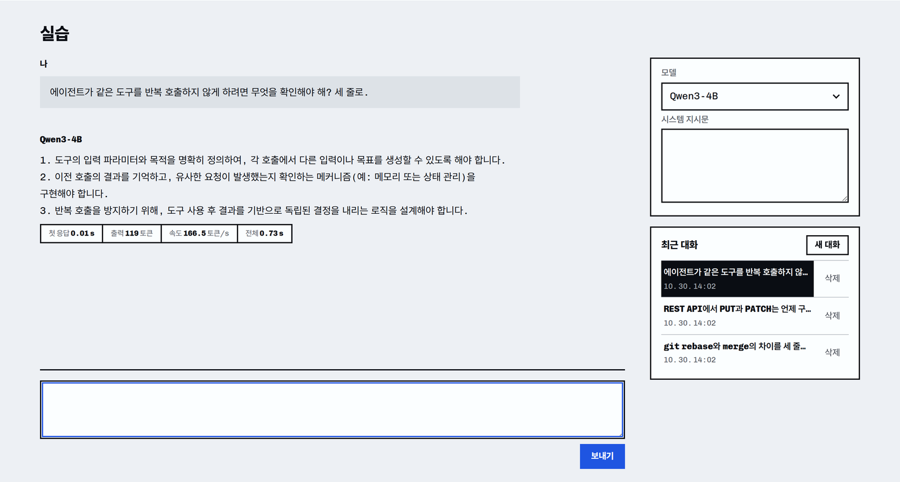

# campus-llm-sharing

공유 GPU 서버에서 여러 LLM을 실행하고 웹 포털과 OpenAI 호환 API로 사용할 수 있는 로컬 LLM 실습 플랫폼입니다. 모델별 서버 실행부터 API 인증, 요청 제어, 대화 기록, 부하에 따른 추론 노드 확장까지 제공합니다.

브라우저에서 모델을 선택해 대화하거나, 기존 OpenAI 클라이언트의 API 주소를 변경해 애플리케이션과 에이전트에 연결할 수 있습니다.



## 주요 기능

- **다중 모델 서빙**: 모델 레지스트리와 배포 프로파일로 실행할 모델과 메모리 할당량을 설정합니다. 같은 GPU에서 여러 모델을 실행하고, 장애가 난 모델의 프로세스 그룹을 정리한 뒤 다시 시작합니다.
- **API 게이트웨이**: API 키 인증, 사용자별 호출 제한, 모델 라우팅을 제공합니다. 입력과 최대 출력 토큰 수를 기준으로 요청을 배정하고 대기열과 타임아웃으로 과부하를 제어합니다.
- **실습 포털**: 스트리밍 채팅, 사용자별 대화 저장, 모델 상태, 사용량 조회와 API 연결 안내를 제공합니다.
- **추론 풀 확장**: 부하가 지속되면 여유 GPU 노드에 모델 서버를 추가합니다. 회수할 때는 새 요청 전달을 중단하고 처리 중인 응답이 끝날 때까지 기다립니다.
- **운영 모니터링**: Prometheus 지표와 Grafana 대시보드로 요청 지연, 대기열, GPU 사용량과 모델 프로세스 상태를 확인합니다.

## 버전별 기능

구성요소별로 버전을 관리합니다. 아래는 기존 개발 기록에서 확인한 주요 변경이며, 현재 배포 설정은 게이트웨이 `0.5.0`, 포털 `0.3.1`, 추론 풀 관리자 `0.3.0`, 서빙 이미지 `0.32.0-r4`를 사용합니다.

| 구성요소 | 버전 | 주요 변경 |
| --- | --- | --- |
| 게이트웨이 | `0.2.0` | 정상 모델 서버 수에 따라 동시 요청 한도를 조정합니다. |
| 게이트웨이 | `0.2.1` | 비스트리밍 도구 호출 응답을 SSE로 변환해 스트리밍 클라이언트에 전달합니다. |
| 게이트웨이 | `0.3.0` | 요청의 토큰 수를 반영한 과부하 제어를 추가했습니다. |
| 게이트웨이 | `0.3.1`–`0.3.2` | 모델 컨텍스트 검사와 제거된 모델 서버의 메트릭 정리를 수정했습니다. |
| 게이트웨이 | `0.4.1` | 사용자별 사용량 조회를 제공하고 스트림 완료 시점의 집계를 수정했습니다. |
| 게이트웨이 | `0.5.0` | 서버별 토큰 한도와 제한된 대기열 추월을 적용했습니다. 스트림 오류를 클라이언트에 전달하고 실패한 요청의 사용량을 구분해 기록합니다. |
| 포털 | `0.3.1` | 모델 선택과 스트리밍 채팅, 사용자별 대화 기록, 사용량과 운영 현황을 제공합니다. |
| 추론 풀 관리자 | `0.3.0` | 부하에 따른 모델 서버 확장과 회수, 전용 노드 장애 시 대체 배치를 제공합니다. |
| 서빙 이미지 | `0.32.0-r4` | vLLM `0.32.0`에서 모델별 프로세스 그룹 정리와 GPU 메모리 해제 확인 후 재시작을 제공합니다. |

## 웹 포털 사용

배포된 포털에 접속해 발급받은 API 키로 로그인합니다.

1. **실습**에서 모델을 선택하고 질문을 입력합니다. 답변을 스트리밍으로 받고 최근 대화를 다시 열어 이어갈 수 있습니다.
2. **모델**에서 제공 모델과 현재 부하를 확인합니다.
3. **사용량**에서 자신의 요청 결과와 토큰 사용량을 확인합니다.
4. **API 안내**에서 연결 주소와 클라이언트 설정 예제를 확인합니다. 운영자 권한으로 로그인하면 운영 현황도 조회할 수 있습니다.

## API로 활용

배포 주소와 발급받은 키를 환경변수로 설정합니다. 아래 localhost 주소는 게이트웨이 포트에 접근할 수 있는 환경을 기준으로 합니다.

```bash
export LLM_BASE_URL="http://localhost:30080/v1"
export LLM_API_KEY="발급받은_API_키"
```

먼저 사용 가능한 모델 이름을 조회합니다.

```bash
curl "$LLM_BASE_URL/models" \
  -H "Authorization: Bearer $LLM_API_KEY"
```

OpenAI Python 클라이언트에서 같은 주소와 키를 사용하면 채팅을 호출할 수 있습니다. `model`에는 모델 목록에서 확인한 이름을 지정합니다.

```bash
pip install openai
```

```python
import os
from openai import OpenAI

client = OpenAI(
    base_url=os.environ["LLM_BASE_URL"],
    api_key=os.environ["LLM_API_KEY"],
)

stream = client.chat.completions.create(
    model="Qwen3-4B-Instruct-2507",
    messages=[{"role": "user", "content": "리스트와 튜플의 차이를 설명해 줘."}],
    max_tokens=512,
    stream=True,
)
for chunk in stream:
    if chunk.choices:
        print(chunk.choices[0].delta.content or "", end="", flush=True)
print()
```

OpenAI 호환 엔드포인트를 지원하는 도구에도 같은 방식으로 연결합니다. 도구 호출과 추론 출력 지원은 모델별로 다르므로 [모델 레지스트리](models/registry.yaml)의 설정을 확인합니다. 호출 한도 초과는 `429`, 대기열 초과나 사용 가능한 모델 서버가 없는 경우는 `503`으로 응답하며 `Retry-After`를 제공합니다.

## 설치와 배포

서비스는 Python 3.12 이상에서 실행하며, 클러스터 배포에는 Kubernetes, NVIDIA GPU 드라이버와 컨테이너 런타임이 필요합니다. 모델 파일, 이미지 저장소, 노드 라벨과 인증 정보를 준비한 뒤 배포 매니페스트를 생성합니다.

```bash
scripts/deploy.sh target build > /tmp/campus-manifests.yaml
```

[배포 절차](docs/deployment.md)에서 이미지 빌드, API 키 등록, 클러스터 적용과 실제 모델 호출 검사를 안내합니다. 포함된 메모리 프로파일은 RTX 5090과 RTX 4090 테스트베드에서 가져왔으므로 사용할 GPU와 모델 조합에 맞춰 조정합니다.

## 개발 환경

GPU 없이 요청 제어, 스트림 오류 처리, 모델 프로세스 정리와 대화 저장 테스트를 실행할 수 있습니다.

```bash
python3 -m venv .venv
source .venv/bin/activate
pip install -r requirements-dev.txt
python -m pytest -q
```

| 경로 | 역할 |
| --- | --- |
| `models/`, `serving/` | 모델 설정, 메모리 계산과 모델 서버 관리 |
| `gateway/` | 인증, 요청 제어와 API 라우팅 |
| `portal/` | 웹 포털과 사용자별 대화 저장 |
| `rental/` | 추론 풀 확장과 회수 |
| `infra/`, `monitoring/` | Kubernetes 배포와 운영 모니터링 |
| `tests/` | 서비스별 회귀 테스트 |
